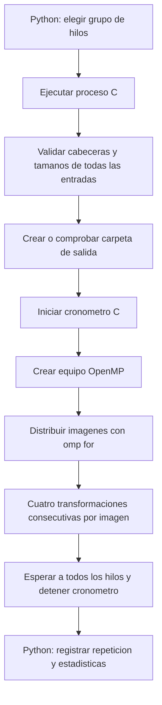

# Arquitectura

## Componentes

| Archivo | Responsabilidad |
|---|---|
| `Transformaciones/Transformaciones.h` | Lectura/escritura BMP, estructuras de píxel y operaciones |
| `bench_mark_transformaciones.c` | Validación del lote, creación de salida y ejecución paralela |
| `benchmark_transformaciones.py` | Configuración de hilos, calentamiento, medición y estadísticas |
| `scripts/generar_imagenes.py` | Creación de entradas sintéticas |
| `original/` | Código recibido sin modificaciones, para consultar su procedencia |

La implementación de las funciones se mantiene dentro de una cabecera, como en el código recibido. Inclúyela en una sola unidad de compilación por ejecutable; sus definiciones externas y los nombres históricos de macros no forman una API empaquetada para proyectos con muchos archivos C.

## Flujo de ejecución



Los calentamientos también siguen este flujo, pero sus tiempos no se guardan como mediciones.

## Paralelismo por imagen

El programa crea una región `omp parallel`, consulta el tamaño real del equipo y usa `omp for schedule(static)` para repartir los índices del lote. Cada iteración procesa una imagen completa. Las variables de rutas y los búferes son propios de cada iteración; cada índice tiene nombres de salida distintos.

Dentro de una iteración se ejecutan, en orden:

1. Espejo horizontal con grises.
2. Espejo horizontal en color.
3. Giro de 180° con grises.
4. Giro de 180° en color.

Cada función abre de nuevo la entrada, lee sus píxeles, transforma, escribe, cierra y libera memoria. No hay paralelismo adicional dentro de sus bucles de píxeles ni una región separada para cada transformación.

Con diez imágenes, como máximo diez iteraciones hacen trabajo simultáneamente. Crear cuarenta hilos no crea cuarenta imágenes ni divide una imagen entre cuarenta trabajadores. El tamaño real del equipo puede superar la cantidad de iteraciones útiles.

## Representación y memoria

`Pixel` contiene los canales **B, G, R**, en el orden usado por BMP. `Pixel_gris` contiene tres bytes iguales. La conversión usa `0.21R + 0.72G + 0.07B` y trunca al convertir a byte.

Para una imagen de `N = ancho × alto` píxeles, una operación en color utiliza aproximadamente `3N` bytes de búfer de píxeles. Una operación con grises utiliza aproximadamente `6N`: original y arreglo de grises. Esto excluye pilas, biblioteca OpenMP, estructuras de archivo y caché del sistema. El desenfoque con grises utiliza aproximadamente `9N`, pero no forma parte del benchmark predeterminado.

Varias imágenes se mantienen en memoria si sus iteraciones coinciden. Al aumentar los hilos, revisa la RAM y el tamaño de las entradas.

## Lectura BMP

La cabecera proporciona la posición de los píxeles, dimensiones, bits por píxel y compresión. Se comprueba que el archivo tenga espacio para todas las filas, que use 24 bits y que no esté comprimido. Se admiten DIB de al menos 40 bytes.

Cada fila ocupa un múltiplo de cuatro bytes:

```text
bytes_de_pixeles_por_fila = ancho × 3
relleno = (4 - (bytes_de_pixeles_por_fila mod 4)) mod 4
```

Una altura positiva almacena las filas desde abajo; una negativa, desde arriba. La versión adaptada usa el valor absoluto para reservar y recorrer los píxeles, conservando el signo original en la cabecera de salida. Las operaciones de espejo y giro funcionan en ambas orientaciones.

Las dimensiones deben ser válidas y su producto no puede superar `INT_MAX`, porque los recorridos originales utilizan índices `int`. La lectura directa de los campos requiere una máquina little endian, como las plataformas habituales x86-64 y Apple Silicon utilizadas con este proyecto.

## Errores

Las operaciones sobre imágenes devuelven 1 si terminan correctamente y 0 si fallan. Se comprueban aperturas, cabeceras, lectura de píxeles, reserva de memoria y errores de escritura/cierre. El programa C acumula los fallos de las iteraciones y devuelve un código de error; Python detiene la medición y no publica un resumen completo de una ejecución fallida.

La validación inicial comprueba todo el lote antes de crear salidas. Un fallo posterior de disco o escritura puede dejar archivos parciales; las operaciones no son transacciones. Las funciones requieren rutas de entrada y salida distintas.
